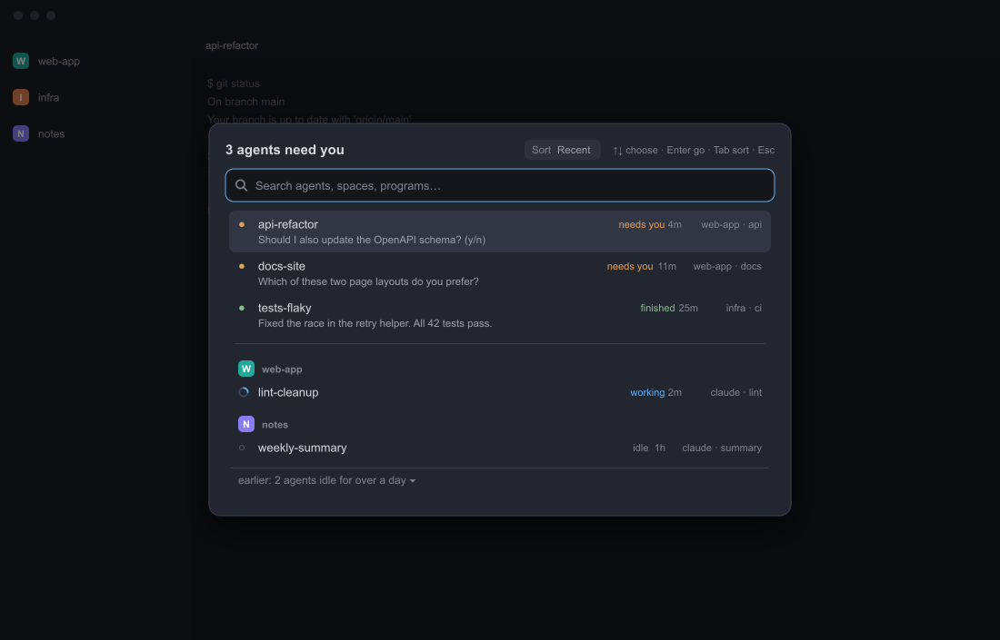

# Agents waiting

A [Herdr](https://herdr.dev) mod: one dialog that answers "which of my agents needs me?"

It lists the agents that are blocked on you, then the ones that have finished, each with a one-line preview of what
it asked and how long it has waited. Under a rule it lists every other agent, grouped by space. You search, sort,
pick one with the keyboard or the mouse, and Herdr takes you to it.



*An illustration drawn with made-up data, not a screenshot.*

- **Needs you first.** Blocked agents, then finished ones, each group in the order Herdr last saw them change, with a
  preview of the question.
- **Everyone else below a rule**, grouped by space, with the space's color. Agents idle for over a day fold into an
  "earlier" line.
- **Search** across name, program, space, tab, title and the status words. Every word must match.
- **Three sorts** for the lower list: Recent, Oldest, Space order. `Tab` cycles them (`Shift+Tab` goes back) and the
  choice is remembered.
- **Standalone.** One folder and one key. No other mod is needed.

## Status

The original mod ran in the author's Herdr on macOS. The changes made since then pass `herdr-app check` (it renders
the mod once) and the unit tests; they have not been watched in a live window yet. Tested on Herdr 0.1.12 only.
What nobody has observed yet is listed, with a 30-second check for each, under [Verification status](#verification-status).
Changes are in [CHANGELOG.md](CHANGELOG.md).

## What it lists

Agents only: terminals whose program reports a status to Herdr (the same list Herdr's own agent panels use). A plain
shell does not appear, and with no agent running the dialog says "No agents running". A finished agent leaves the top
list once you have looked at it, because Herdr then calls it idle; it then sits under the rule with the others.

## Install

### With a Herdr agent

Paste this into an agent that works in your Herdr home:

```text
Add the Herdr mod from https://github.com/miguelalexanderdiaz/herdr-agents-waiting
(the folder mods/attention-picker). Read RECIPE.md and AGENTS.md in that repo first and
tell me what the mod reaches before you copy anything. Merge its keys.json into mine and
ask me before replacing any key I already use. Then run herdr-app check on the mod folder.
```

When the repository is public and listed, `herdr.dev/mods/miguelalexanderdiaz/herdr-agents-waiting` works the same
way. Agents: read [AGENTS.md](AGENTS.md).

### By hand

1. Get the files: `git clone https://github.com/miguelalexanderdiaz/herdr-agents-waiting.git`, or download the zip.
2. Copy the `mods/attention-picker` folder, whole, into the `mods` folder of your Herdr app home (Herdr's
   documentation gives `~/.config/herdr-app`; `HERDR_APP_HOME` moves it, see `herdr-app --help`). Copy all of it:
   `main.js` imports `logic.js` and `ask.js`, and the icons load from `mods/attention-picker/`.
3. Add the key to your `keys.json`, in both the `global` and `terminal` sections. If you already use that key, choose
   another; do not overwrite yours.

   ```json
   {
     "global":   { "ctrl-shift-a": "mod.open:attention-picker" },
     "terminal": { "ctrl-shift-a": "mod.open:attention-picker" }
   }
   ```

4. Check it: `herdr-app check ~/.config/herdr-app/mods/attention-picker`. Herdr loads mods and keys live, so there
   is no restart. Then, from a clone of this repository, run
   `node scripts/verify-install.mjs ~/.config/herdr-app/mods/attention-picker --home ~/.config/herdr-app`
   (Node 22 or newer; or set `HERDR_APP_HOME` instead of `--home`). It checks the folder name against `HOME`, the
   icons, `mod.json` and that your `keys.json` has a key for `mod.open:attention-picker`. It is read-only.
5. Press `Ctrl`+`Shift`+`A`.

`herdr-app check` proves the code loads and renders once. It does not run the timers or screen reads that start
later, and it passes a broken `mod.json` or a renamed folder whose `HOME` constant was not changed; that is what
`verify-install.mjs` is for. Also open the dialog in the app.

**Name clash.** If you already have a mod called `attention-picker`, do not overwrite it. Install this one under
another name and change three places: the folder, the `HOME` constant at the top of `main.js`, and the name in your
`keys.json` line (`mod.open:<new name>`).

## Open it

| Way | How |
|---|---|
| Key | `Ctrl`+`Shift`+`A` (the key in this repo's `keys.json`). Pressing it again should close it (`mod.open` toggles); `Esc` always does. |
| Another key | Put `"<key>": "mod.open:attention-picker"` in the `global` and `terminal` sections of `keys.json`. |
| Command palette | `mod.open` takes a `name` argument (`attention-picker`); how the palette asks for it has not been tried. |
| A terminal | `herdr-app do mod.open '{"name":"attention-picker"}'` (running it again closes it). |
| Another mod | `openOverlay({ mod: "attention-picker", kind: "dialog", width: 640 })`. Pass `props: { search: false }` for the keys-only variant. |

## Use it

| Key | Does |
|---|---|
| Typing | Filters the list (the search box is on by default). |
| `Up` / `Down` | Move the selection (wraps). It stays on the same agent when the list reorders. |
| `Enter`, click | Go to the agent: Herdr focuses it and the dialog closes. On the "earlier" line it folds or unfolds. |
| `Tab` / `Shift+Tab` | Next / previous sort: Recent, Oldest, Space order. |
| `Esc` | Close. |
| `1`-`9` | Jump to a numbered agent, only in the keys-only variant (`search: false`). |

The time beside a status is how long the agent has been in it. The mod takes the start from, in order: the shared
`agents.since` value if another mod publishes it (ignored for a blocked or working agent that is alone in its tab
when the tab shows a change more than 10 seconds newer), the agent's tab `changed_at` from Herdr, or the first time
the dialog saw the agent in that status. The dialog only exists while it is open, so it cannot see changes that
happen while it is closed: with only the third source, an agent that went idle yesterday counts from your next open.
The times on screen refresh every 30 seconds while the dialog is open.

Previews are best effort. They are tuned to Claude Code style screens (question boxes, numbered choices, `(y/n)`
hints, bullet message lines that start in the first column). Other agents may show a blank second line; the row
still works. A screen that has not changed is read again about every 30 seconds instead of every 3; a change of the
agent's status, or of Herdr's sequence number for it, is read at once, so a question that appears without either
may show up to about 30 seconds late.

More in the documentation site (plain HTML in [docs/](docs/index.html): [install](docs/install.html),
[usage](docs/usage.html), [configuration](docs/configuration.html), [how it works](docs/how-it-works.html),
[troubleshooting](docs/troubleshooting.html)). Once the repository is public and GitHub Pages is on, the site is at
`https://miguelalexanderdiaz.github.io/herdr-agents-waiting/`.

## Requirements

| | Needs |
|---|---|
| Herdr app | Tested on 0.1.12 only. The mod uses only Herdr's documented mod API. |
| Other mods | None. |
| Node, npm, network | None to run it. Node 22 or newer only to run this repo's tests. |
| macOS | The original mod ran in the author's Herdr. The changes since then are not yet watched in a live window. |
| Linux, Windows | Not run in Herdr. The mod is plain JavaScript with no operating-system calls. CI is defined in `scripts/ci.workflow.yml` (Linux, Windows and macOS, each on Node 22 and 24); it is enabled when the owner installs it and has not run yet. Until a run is green, treat Linux and Windows as unchecked. |

## Verification status

What has not been observed yet. Each row is something a first observer can settle in about 30 seconds; when one is
seen, it moves to "observed on <OS>, Herdr <version>".

| Not yet observed | How to check in 30 seconds |
|---|---|
| The key closes the dialog while the search box has focus. | Open with `Ctrl`+`Shift`+`A`, press it again. If it stays open, `Esc` closes it. |
| `Tab` / `Shift+Tab` change the sort while the search box has focus. | Press `Tab`: the "Sort" pill at the top right goes from Recent to Oldest. If not, click the pill. |
| The first-seen times in `localStorage` survive a reload. | Close the dialog, restart Herdr, open it: a time that came from the first-seen record keeps counting instead of restarting at `<1m`. |
| `hc read <address> --lines 60` returns the screen plus 60 lines of history. | Run it and `hc read <address>` for one agent and compare the line counts (`hc read --help`). |
| The unit of a tab's `changed_at` and what it marks. | Note when an agent in a tab of its own went blocked, then open the dialog: the time should match your clock. |
| Polling stops when the dialog closes. | With a blocked agent waiting and the dialog closed, watch for `hc read` calls in a process monitor: none should start. |
| The palette entry for `mod.open`. | Open the palette, look for `mod.open`, see whether it asks for a name. |
| The 30-second redraw of a quiet dialog, so "5m" becomes "6m". | Leave the dialog open for a minute with an agent that has a time. |
| A question that appears without Herdr's sequence number moving shows up within about 30 seconds. | Let an agent ask something while the dialog is open and time the preview. |
| Linux and Windows. | Install and open the dialog there. |

## Privacy and permissions

What this mod does on your machine, so you can decide before installing:

- **Reads other terminals' screen text.** While the dialog is open, every 3 seconds it runs
  `hc read <address> --lines 60` (Herdr's own tool; the screen plus up to 60 lines of history above it; at most 4
  at a time) for agents that are blocked or finished, and shows one line of it. That line lives in memory and goes away when the dialog closes.
  It is never written to disk or sent anywhere.
- **Stores two small things.** A map from agent address to the time it was first seen in its current status (with
  the status group, Herdr's sequence number for the agent and its space id), in the mod's own `localStorage` (key
  `attention.seen`, no screen text), and your sort choice in Herdr's shared state (`attention.sort`).
- **Reads shared values** `agents.since` and `space.colors` if present. It never writes them.
- **No network, no `exec`, no file access.** The only program it runs is `hc read`. Choosing a row calls Herdr's
  `agent.focus`; it sends no input to any terminal.

This is the mod's own policy, not a sandbox. Herdr gives mods `exec`, `fetch` and file access and does not restrict
them; this mod uses none of them besides the one `hc read` call, and `scripts/validate.mjs` checks that. You are
trusting this code: read `mods/attention-picker/main.js`, or run the `rg` commands in [AGENTS.md](AGENTS.md).

Herdr's instructions ask an installing agent to tell you this before it adds a mod. [AGENTS.md](AGENTS.md) and
[RECIPE.md](RECIPE.md) say the same.

## Troubleshooting

| Symptom | Try |
|---|---|
| The key does nothing | Check both `global` and `terminal` sections and that `keys.json` is valid JSON. Another program, or a `layout:<name>` section, may use the key: bind a different one. Test with `herdr-app do mod.open '{"name":"attention-picker"}'`. |
| It says "No agents running" | Only terminals whose program reports a status count. A plain shell does not. |
| No spinner or search icon | The icons load from `mods/attention-picker/`. After renaming the folder, change `HOME` in `main.js`. |
| No search box | It was opened with `search: false`. Open it with its own key. |
| No time on a row | No source has a start for that agent yet; it appears once the dialog has seen it. See "Use it". |
| Blank second line | Nothing recognizable on that terminal's screen. Other agents than Claude Code style ones may show nothing. |
| The dialog is cut off | It needs a window about 440 px tall. Make the window taller or zoom out. |

Longer answers: [docs/troubleshooting.html](docs/troubleshooting.html). Report problems on the repository's issue
tracker (the [bug report form](.github/ISSUE_TEMPLATE/bug_report.yml) asks for your Herdr version, `herdr-app
--version`, and OS). Report a security problem privately, as [.github/SECURITY.md](.github/SECURITY.md) describes.

## Uninstall

Delete the `mods/attention-picker` folder from your Herdr home and remove the `mod.open:attention-picker` lines from
`keys.json`. The shared value `attention.sort` and the mod's stored first-seen times are left behind; nothing reads
them once the mod is gone.

## Contribute

See [CONTRIBUTING.md](CONTRIBUTING.md). Tests: `npm test` (which runs `node --test`, Node 22 or newer).
Agents editing this repo: [AGENTS.md](AGENTS.md).

## License

Apache-2.0, see [LICENSE](LICENSE) and [NOTICE](NOTICE).
