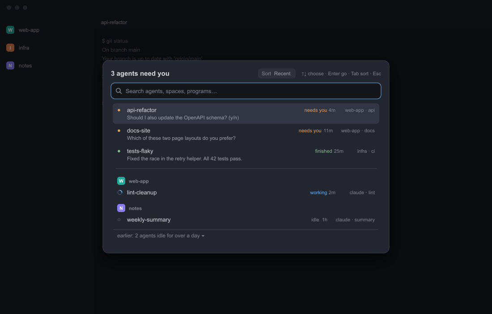

# Agents waiting

A dialog that answers one question: which of my agents need me? Press one key and a centered list opens with the agents that are blocked on a question first, then the ones that finished, each with the question or last message it left and how long it has waited. Under a rule come all the other agents, grouped by space. A search box on top finds any of them; Enter jumps to the one you picked. This is a piece you add to your current layout, not a whole window, and it needs no other mod.



This file is the brief: enough to build Agents waiting from an empty folder. The files next to it are one build of it. If they don't work on your Herdr, or you want it different, build it again from here. `preview.png` is an illustration drawn with invented data, not a screenshot.

## What you see

- A dialog, 640px wide, opened over the layout. Height follows the content (at most about 440px with a full list). Nothing is added to the layout itself.
- The dialog uses the theme's `popover` background, 18px padding, 10px between its parts, 13px text.
- **Header row.** On the left the title, 15px semibold: "N agents need you" ("1 agent needs you"), else "N finished", else "Nothing needs you right now" (or "No agents running" when there are none at all). The title counts every blocked or finished agent; typing in the search box never changes it. On the right a **Sort** pill, 22px high, 6px radius, `raised` background, 11.5px: the word "Sort" in `dim` and the current order in `muted` ("Recent", "Oldest" or "Space order"); then a key hint in 11px `dim`: "↑↓ choose · Enter go · Tab sort · Esc".
- **Search box.** 36px high, 9px radius, 1px `accent` border, `background` fill, a 15px magnifier icon in `dim`, 12.8px text, placeholder "Search agents, spaces, programs…". It has focus when the dialog opens.
- **List**, at most 320px high, every row at a fixed height, scrolled when it does not fit. From top to bottom:
  - **Waiting rows**, 46px: first the agents that need you (blocked), then the finished ones (done), each group in the order Herdr last saw them change (its `seq`, lowest first), which is not always the order of the times shown. Line one (20px): a 12px status mark, the agent's name in `foreground`, the status word and the time waited (11px), and on the right the space and tab ("space · tab", 11px `dim`, at most 200px). Line two, 11.5px `muted`: the question or last message the agent left, one line, cut with an ellipsis. It shows "…" until the first read returns.
  - A **rule**, 17px: a 1px `border` line, only when there are rows above and below it.
  - **Space heads**, 29px: an 18px tile with 5px radius in the space's color and its first letter in 10.5px bold (`#111111` or white, whichever has more contrast with that color), then the space name in 11px semibold `dim`. A space's color is its entry in the shared `space.colors`: `#rgb`, `#rrggbb` or `#rrggbbaa` (the alpha is dropped), or a color name, looked up first among six built-in tile colors (`ansi1` `#d9649a`, `ansi2` `#3fae6a`, `ansi3` `#e3814f`, `ansi4` `#5b8def`, `ansi5` `#8b7cf6`, `ansi6` `#22a99a`) and then in the theme; anything else, or no entry, gives `ansi6`. The space named `~` (the home folder) is always drawn in `dim`.
  - **Agent rows**, 32px: one line, as line one above, with "program · tab" on the right.
  - An **earlier line**, 35px, last: "earlier: N agents idle for over a day ▾" (▴ when open), 12px `dim`, with a top border.
- The selected row has a `hover` background and 7px radius; rows have 4px side margins and 10px padding. The mouse hover shows the same background.

## How it behaves

Every status, as the status mark and word show it:

| Status | Mark | Word | Where it sits |
| --- | --- | --- | --- |
| blocked | `●` in `blocked` color | "needs you" in `blocked` color | top, with its question on line two |
| done | `●` in `done` color | "finished" in `done` color | top, after the blocked ones |
| working | a 12px spinner ring turning every 900ms, `working` color | "working" in `working` color | under the rule, grouped by space |
| idle | `○` in `dim` | "idle" in `dim` | under the rule, grouped by space |

After the word comes the time since that status began ("<1m", "5m", "3h", "2d"). Under the rule the agents are ordered by the Sort pill: **Recent** (latest status change first), **Oldest** (longest idle first) or **Space order** (as the space tree lists them); spaces follow their first agent. The choice is shared (`attention.sort`) so every copy of the mod agrees. Agents that are not working, not focused and whose status began more than 24 hours ago fold into the earlier line (an agent whose time is unknown never folds); searching opens the fold. Clicking that line, or choosing it and pressing Enter, opens or closes it.

Where the time comes from, best first: the shared `agents.since` map when a layout publishes one (milliseconds since the epoch); else the tab's own `working_since` (working) or `changed_at` (anything else); else the time this mod first saw that status, which it keeps itself. A tab time smaller than 1e11 is read as seconds and multiplied by 1000. No time is later than now. A shared `agents.since` is persisted by the layout that writes it, so one left behind can name an old time for an agent that has changed since; it is therefore ignored for a blocked or working agent that is alone in its tab when the tab shows a change more than 10 seconds newer (`changed_at` for blocked, `working_since` for working). The dialog only exists while open, so a change that happens while it is closed is dated by the tab time, or by the next time you open it. Times are approximate, and an open dialog redraws every 30 seconds (`TICK_MS`) so "5m" becomes "6m". Under Recent and Oldest an agent whose time is unknown goes last.

Keys and mouse:

| Input | What it does |
| --- | --- |
| `Ctrl+Shift+A` | Opens the dialog. `mod.open` toggles a mod's overlay, so pressing it again should close it (not yet observed, see Watch out); `Esc` always does |
| `↑` / `↓` | Move the selection through the rows you can pick, wrapping at both ends. The selection follows the agent, not the row, when the list reorders |
| `Enter` | Show the selected agent and close; on the earlier line it opens or closes the fold instead |
| Typing | Filters live. Every word you type (split on spaces, case ignored) must appear somewhere in the agent's name, program, space name, tab name, terminal title, status word ("needs you", "finished", "working") or status name ("blocked", "done", "idle"), in any order. No match shows "No match" |
| `Tab` / `Shift+Tab` | Next / previous sort order |
| Click the Sort pill | Next sort order; its tooltip names the current one and the next |
| Click a row | Show that agent and close |
| Mouse wheel | Scrolls the list; the selection follows |
| `Esc` | Closes without doing anything |
| `1`–`9` | Only when opened with `props.search` set to `false` (no search box): jump to the numbered row |

Showing an agent runs `agent.focus` with its terminal address. When nothing is running the list says "No agents running" and "Start one and it will show here"; when agents exist but none waits, the title is "Nothing needs you right now".

## Built from

- **One mod**, `mods/attention-picker/`: `main.js` (the view), `logic.js` (row building, sorting, search, selection, status times, the preview reader; no Herdr imports), `ask.js` (reads a question out of screen text; pure), `spinner.svg` and `search.svg` (24x24, `currentColor` strokes, drawn for this mod) and `mod.json`: `{ "place": "none", "title": "Agents waiting", "overlay": { "kind": "dialog", "width": 640 } }`. So it never docks into a layout; it only opens as an overlay. No `layouts/` folder.
- **A `keys.json` snippet**, merged into the person's keys, never replacing a key they use:

  ```json
  {
    "global": { "ctrl-shift-a": "mod.open:attention-picker" },
    "terminal": { "ctrl-shift-a": "mod.open:attention-picker" }
  }
  ```

  The `terminal` entry matters: a focused terminal uses the more specific section, so without it the key would reach the program instead.
- **View:** `View`, `div`, `svg` from `gpui-kit`; `v_flex`, `h_flex`, `InputState`, `Input` from `gpui-base`. The strip is laid out with absolute rows at fixed heights (head 29, agent 32, waiting 46, rule 17, earlier 35) inside a list capped at `LIST_H` = 320 (px), scrolled by hand.
- **`herdr` functions:** `agents`, `spaces`, `run`, `hc`, `theme`, `settings`, `shared`, `setShared`, `props`, `closeOverlay`. Theme colors used: `popover`, `background`, `foreground`, `muted`, `dim`, `accent`, `border`, `raised`, `hover`, `blocked`, `done`, `working`, and `ansi*` names for space colors.
- **Data it reads.** From `agents()`: `address`, `status` (`blocked`, `done`, `working`, `idle`), `space` (id), `space_name`, `tab` (id), `tab_name`, `title`, `program.name`, `app`, `focused` and `seq` (higher = changed more recently). From `spaces()`: each space's `id`, `name` and `tabs[]`, and in each tab `id`, `changed_at` and `working_since` (epoch milliseconds; a value below 1e11 is taken as seconds, see How it behaves). From `settings()`: `zoom`, to size the list. Only agents are listed, not plain shells.
- **The agent's name.** Its terminal title with leading symbols and spaces removed, unless the raw title looks like a path (it starts with `~` or `/`, with a drive letter and `:\`, or with `\\`), contains `@` (user@host), or equals the program name. Then the tab's name when it is not just a number; else `program.name`; else `app`; else "agent".
- **Props:** `search`. Only `false` turns the search box off; anything else, including no props at all, shows it. `props().overlay` (the overlay id Herdr supplies) is used to close itself.
- **Shared keys:** read `agents.since` (`{ address: ms }`, wins when present, see How it behaves), read `space.colors` (`{ spaceId: color }`, see What you see), read and write `attention.sort` (`"recent" | "oldest" | "space"`; anything else reads as `recent`). This mod never writes `agents.since`. Whatever those keys hold was written by other mods, so odd values (a number, null, an unknown name) must fall back, never throw.
- **Commands:** `agent.focus {terminal}` to show the agent; `mod.open` (from the key); `overlay.close` only as a fallback when the overlay id is missing. It closes itself with `closeOverlay(props().overlay)`. No other command is run.
- **Programs:** `hc read <address> --lines 60`, for agents that are blocked or done, every `POLL_MS` = 3000 ms while the dialog is open, one pass at a time, at most `READ_CONCURRENCY` = 4 reads at once, and no pass when nothing is waiting (`READ_LINES` = 60). `--lines` asks for the history above the screen, so a read returns the screen plus up to 60 lines of history (that reading of `hc read --help` is not yet observed, see Watch out). A screen that has not changed is not read again: when an agent has the same status and `seq` as at its last read, and the last two reads gave the same text, it is skipped, for at most 10 passes in a row (about 30 seconds); a failed read is retried every pass. The result goes through `ask.js`: only the last 40 non-empty lines count; ANSI escapes and box-drawing characters are removed; for a question, a leading marker, a selection arrow (`>`, `❯` or `›`) and a list number are ignored. For a blocked agent the last line ending in `?` (a trailing `(y/n)` or `[y/N]` is allowed), else the last message line that starts with `●`, `⏺` or `•` and is indented by at most one space and is not a tool call such as `Bash(npm test)` (a tool call is shown only if nothing else is there); at most 200 characters.
- **Storage:** `localStorage` key `attention.seen`: `{ address: { s, at, q, sp } }` where `s` is the status group (`working`, `blocked`, or `rest` for done and idle), `at` the time it was first seen (ms), `q` the agent's `seq` then and `sp` its space id (records with only `s` and `at` still read). A lower `seq` or a different space starts a new record. No screen text. It is written only when it changes, pruned to the agents that exist (not while the agent list is empty), and capped at 500 entries when read.
- **Art:** the two SVGs and the colors above; nothing is fetched.
- **Licence:** each `.js` file starts with `// SPDX-License-Identifier: Apache-2.0` and a copyright line, so a copy of the folder still carries its licence. Keep them.

## Watch out

- **What it reaches. Tell the person before adding it.** Herdr's installers warn about network use, programs and files outside the mod folder; here is the whole list, from the code:

  | Reaches | This mod |
  | --- | --- |
  | Network | none |
  | Programs | `hc read <address> --lines 60` only: it reads the text on the screens of agents that need you or finished (and 60 lines of history), while the dialog is open. One line per agent is kept in memory, shown, and never written to disk or sent anywhere |
  | Terminal input | none (it never sends keys or text to a terminal; `agent.focus` only shows one) |
  | Files | none; its two icons load from its own folder |
  | Storage | `localStorage` key `attention.seen` in the mod's own storage: agent address, status group, time, `seq`, space id; no screen text |
  | Shared keys | reads `agents.since` and `space.colors`; reads and writes `attention.sort` |

  `node scripts/validate.mjs` checks this list against the source in the repository (imports, `run`, `hc` calls); that is a policy check on the code, not a sandbox.
- **`Ctrl+Shift+A` is taken from terminal programs.** Bind another key by editing `keys.json`: `"<key>": "mod.open:attention-picker"` in both sections. Avoid `cmd-` (not on Linux or Windows), `ctrl-alt-` (AltGr on Windows) and Option (types characters on a Mac). Existing key bindings can win over a new one; resolve a conflicting `ctrl-shift-a` in the active `layout:<name>` section.
- **Name clash.** If `mods/attention-picker` is taken, rename the folder and change the same name in two more places: `const HOME = "mods/attention-picker"` at the top of `main.js` (the only place the folder name is written in code), and the `mod.open:` value in `keys.json`. The shared key names (`attention.sort`, `agents.since`, `space.colors`) and the prop name `search` must not change: another layout may rely on them.
- **Fixed size.** The list is 320px high at most, so the dialog needs a window about 440px tall; the width is 640px. Check it fits.
- **The question preview is a guess.** `ask.js` reads plain screen text and is tuned to Claude Code style screens (a `●` message line, a `?` question). Other agents may show a different line or nothing; the row still works. Colors and fonts come from the theme, so contrast depends on it (the dim 11px text is the weakest part on a light theme).
- **Times.** They start counting when the status is first seen unless the tab or a layout supplies a time (see How it behaves), and they are not exact. Nothing records history while the dialog is closed.
- **The home space.** A space literally named `~` has its tile drawn in `dim` instead of a color. That is cosmetic; nothing else depends on the name.
- **Platforms.** Pure JavaScript, no OS-specific paths, fonts or programs besides Herdr's own `hc`, and keys without `cmd`. What was run, and where: the mod as the author ran it before round 1 ran in the app on macOS; the current code passed `herdr-app check` (herdr-app 0.1.12, macOS) and the unit and harness tests (Node 22.14 and 26.5 on macOS), and has not been watched in the running app. Nothing has run on Linux or Windows. CI is defined in `scripts/ci.workflow.yml` (Linux, Windows and macOS, each on Node 22 and 24); it is enabled when the owner installs it and has not run yet.
- **Not yet observed in the running app.** (1) That `Ctrl+Shift+A` pressed again closes the dialog while the search box has focus (`mod.open` toggles, so it should; `Esc` always works). (2) That `Tab` and `Shift+Tab` reach the dialog's key handler while the search box has focus. (3) That `hc read <address> --lines 60` returns the screen plus 60 lines of history. (4) That the 30-second redraw repaints in the live host. (5) That a question appearing without `seq` moving shows up within about 30 seconds. (6) The dialog on Linux and Windows. Do not treat any of these as proven.
- Follow the installed `herdr.d.ts` and `gpui-kit.d.ts`, never modify shipped mods, and do not commit the `gpui-kit.d.ts` and `jsconfig.json` files Herdr writes into the folder. `View.close()` is the host's cleanup hook, so the mod's own close method is named `dismiss`.

## Done when

- `herdr-app check mods/attention-picker` passes with the matching Herdr binary and home (it proves the code loads, not that `mod.json`, the folder name or the key are right). In this repository `node scripts/verify-install.mjs <installed folder> --home <Herdr home>` checks those too.
- With `keys.json` merged into an empty Herdr home, `Ctrl+Shift+A` opens a 640px dialog with the search box focused and no other mod installed; `Esc` closes it.
- With one blocked agent and one finished agent, the title reads "1 agent needs you", both sit above the rule with their status words, a time waited and a one-line preview of what they left (blocked first), and the key hint reads "↑↓ choose · Enter go · Tab sort · Esc".
- Typing two words that both appear in one agent's name or space leaves only that agent, and the title still counts every waiting agent; typing nonsense shows "No match".
- `Tab` cycles Recent, Oldest, Space order and `Shift+Tab` goes back; the new order is still there after closing and reopening, and the Sort pill shows it.
- `↑`/`↓` wrap at both ends, and `Enter` or a click focuses that agent's terminal and closes the dialog.
- An agent idle for more than 24 hours (with a known time, not working, not focused) is only listed inside the "earlier" line, which opens on click and while searching.
- With no agents running, the dialog says "No agents running" and "Start one and it will show here".
- A `space.colors` value that is a number, `null` or an unknown name does not blank the dialog: that space's tile takes the default color.
- No `fetch`, `exec` or file access in `mods/` (`rg "fetch\(|exec\(|readTextFile|writeTextFile" mods/` finds nothing), `run(` is only called with `agent.focus` and `overlay.close`, `hc(` only with `["read", ...]`, and no home path, e-mail or name in any file.
- Search on or off is decided by `pickSearch(props)` in `logic.js`: no props, `{}` and `{ search: true }` give a search box, `{ search: false }` gives none and `1`–`9` jump to the numbered rows. A layout that passes `search: false` shows the keys-only form; a builder with no such layout checks the function in the unit tests.
